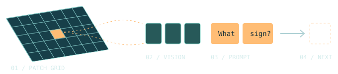

---
hide:
  - toc
---

Engineering field guide &nbsp; / &nbsp; Multimodal systems

# From BEV to Tokens

**You can lift a camera feature into a BEV grid. What does it take to turn that feature into a word?**

[Start with Chapter 01 →](ch01-the-landscape.md){ .cover-link }

## Open the book at …

- **I · Foundations**  
  [How does a decoder see a patch?](ch05-bridging-vision-to-language.md)  
  Compare a projector that keeps every patch with queries that compress a whole frame.
- **II · The blueprint**  
  [Build the forward pass](ch06-llava-the-blueprint.md)  
  Follow one image and one question all the way to the first supervised token.
- **III · Production**  
  [Price a high-resolution image](ch09-inference-and-serving.md)  
  Count its tokens twice: once for prefill, then for the cache that stays resident.
- **IV · Interview studio**  
  [Take the whiteboard round](ch12-interview-playbook.md)  
  Size a cache, defend a connector, and design a fleet-data pipeline.

## Pick a reading route

**Want to understand the mechanism, not just remember the answer?** Start with
the **Why → What → How** worked examples: [false negatives in CLIP](ch03-clip-contrastive-pretraining.md#worked-example-the-hard-negative-that-isnt-negative),
[resize, tile, or crop](ch04-vision-encoders.md#worked-example-resize-tile-or-crop),
[OCR after compression](ch05-bridging-vision-to-language.md#worked-example-why-did-ocr-get-worse-after-compression),
[the first supervised token](ch06-llava-the-blueprint.md#worked-example-trace-the-first-supervised-token),
[LoRA training memory](ch07-finetuning-and-alignment.md#worked-example-what-lora-saves-and-what-it-doesnt),
[KV under burst load](ch09-inference-and-serving.md#worked-example-budget-a-burst-of-document-questions),
and [testing whether the model used the image](ch11-evaluation.md#worked-example-did-the-model-use-the-image-or-guess-from-the-prompt).

**Interview tomorrow?** Read the [architecture map](ch01-the-landscape.md), [decoder essentials](ch02-the-llm-refresher.md), [LLaVA walkthrough](ch06-llava-the-blueprint.md), and [serving math](ch09-inference-and-serving.md). Then close the book and try the [interview problems](ch12-interview-playbook.md).

**Building a model?** Work through Chapters 1–8 in order. Sketch the shapes beside each pseudocode block. At each **Checkpoint**, give your answer before opening the explanation.

**Coming from a driving team?** Pair [VLMs for autonomous driving](ch10-vlms-for-autonomous-driving.md) with [evaluation](ch11-evaluation.md). Ask which claims can be checked from pixels and which need your geometric stack.
